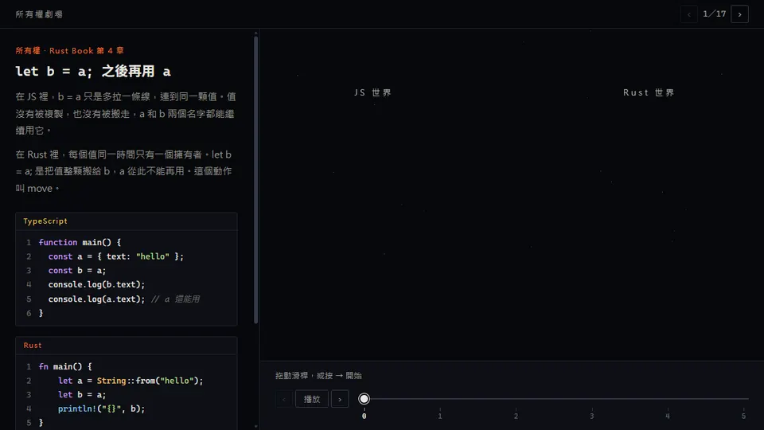

# 所有權劇場

不做翻譯機，做一本會動的圖鑑：讓只會 TS／JS 的工程師看到「值在記憶體裡的命運」在 Rust 與 JS 有什麼不同。

線上版：<https://sylvia-h.github.io/ownership-theater/>



推送到 `main` 會由 `.github/workflows/deploy.yml` 自動跑測試、build 並發布到 GitHub Pages；測試或首屏體積檢查不過就不會發布。

## 指令

| 指令 | 用途 |
| --- | --- |
| `npm run dev` | 開發。 |
| `npm run build` | 型別檢查、打包、首屏體積檢查，任一步失敗就中止。 |
| `npm test` | 軌跡核心的測試、「軌跡對 rustc」的檢查，以及 LeetCode 對照區的檢查。 |
| `npm run verify:rust` | 把每頁的 Rust 片段送到 Rust Playground，用真的 rustc 編譯，結果寫進該頁的 `verified.json`。需要網路；只重送內容有變的片段，加 `--force` 全部重驗；後面接資料夾名稱（可多個）只處理那幾頁，例如 `npm run verify:rust -- 02-copy-vs-move 05-shared-borrow`；LeetCode 對照區的題目加 `lc/` 前綴，例如 `npm run verify:rust -- lc/01-two-sum`。 |

## 架構

分三層，分開做、分開驗。

**軌跡層 `src/core/`**

- `trace.ts`：事件型別。
- `worlds.ts`：JS 與 Rust 兩個世界的狀態與規則。`checkRust` 是本專案對 borrow checker 的理解。
- `timeline.ts`：`buildTimeline` 算出每一步的畫面快照，`stateAt(timeline, t)` 在快照之間內插。

整個場景是時間 t 的純函式，沒有累積狀態，所以滑桿往回拖就是倒著演。

軌跡層目前涵蓋的概念：範圍（函式與 `{ }`）、move 與 Copy、回傳、GC、借用（`&`、`&mut`、slice、NLL）、盒子與 match（Option／Result）、生命週期的綁定、共享擁有（Rc 的計數）、執行期借用（RefCell，違規是 panic 而不是編譯錯誤）、管線（惰性的迭代器）。每個事件的語意寫在 `trace.ts` 的註解，規則與對應的 rustc 錯誤碼寫在 `worlds.ts`。

**渲染層 `src/scene/`（three.js）與 `src/ui/`（Preact）**

場景只吃 `stateAt` 的輸出。

**真相來源：rustc**

畫面上的錯誤訊息是 `verified.json` 裡的原文（rustc 的編譯錯誤，或執行時的 panic 訊息），不是手打的。

## 每一頁的檔案

每頁一個資料夾 `src/pages/NN-slug/`：

| 檔案 | 內容 |
| --- | --- |
| `snippet.rs`、`snippet.ts` | 兩邊的程式碼。 |
| `broken.rs` | 「弄壞它」對應的版本：編譯失敗，或編譯通過但執行時 panic。沒有「弄壞它」的頁沒有這個檔案。 |
| `expect.json` | 每個 `.rs` 的期望：`pass`、rustc 錯誤碼（例如 `E0382`），或 `panic`。 |
| `verified.json` | `npm run verify:rust` 產生，不要手改。 |
| `trace.ts` | 手寫的軌跡，以及「弄壞它」的設定（沒有的頁匯出 `breakIt = null`）。 |
| `index.ts` | 把以上組成一頁。 |

新增一頁還要在 `src/pages/index.ts` 註冊。

## 新增一頁

1. 寫兩邊的片段：`snippet.rs`、`snippet.ts`，有「弄壞它」的話再加 `broken.rs`。
2. 寫 `expect.json`。
3. 跑 `npm run verify:rust`，並親眼看一次 rustc 的錯誤訊息（或 panic 訊息）。
4. 寫軌跡 `trace.ts`，組成 `index.ts`，在 `src/pages/index.ts` 註冊。
5. 跑 `npm test`。
6. 寫白話說明與 Rust Book 引文。引文要對過官方原文。

## LeetCode 對照區

17 頁之外的另一區，不演動畫：同一題 LeetCode，TS 與 Rust 各一份解法逐行並排，一對一對應的行變灰，Rust 多出來的東西亮起來並標上類別（借用、所有權的搬移、Option 的處理、共享擁有、型別與轉換）。目前五題：Two Sum、Reverse String、Group Anagrams、Reverse Linked List、Invert Binary Tree。

每題一個資料夾 `src/lc/NN-slug/`：

| 檔案 | 內容 |
| --- | --- |
| `solution.rs`、`solution.ts` | 完整可執行的程式：解法加上測試外殼（跑幾組測資並印出結果）。兩邊印出的內容要逐字相同。 |
| `expect.json` | 固定是 `{ "solution.rs": "pass" }`。 |
| `verified.json` | `npm run verify:rust -- lc/NN-slug` 產生，不要手改。送去編譯的是整個 `solution.rs`。 |
| `rows.ts` | 手寫的逐行對齊表，格式與規則見 `src/lc/types.ts`。 |
| `index.ts` | 把以上組成一題。 |

新增一題還要在 `src/lc/index.ts` 註冊。

**標記**：`solution.rs` 與 `solution.ts` 各用兩行註解把顯示給讀者的解法框起來，標記之外的測試外殼不顯示。`rows.ts` 的行號是標記之間的行號，從 1 起算。

```rust
struct Solution;

// --- solution ---
impl Solution {
    // 顯示給讀者的解法
}
// --- end ---

fn main() { /* 跑測資、println! 結果 */ }
```

`solution.ts` 要能用 `node solution.ts` 直接執行，所以只能用可抹除的型別語法；解法照 LeetCode 上的寫法，不跟著專案較嚴的 tsconfig 檢查（`tsconfig.json` 的 `exclude` 排除了 `src/lc/**/solution.ts`）。

**驗證**：改過 `solution.rs` 就重跑 `npm run verify:rust -- lc/NN-slug`，再跑 `npm test`。測試（`src/lc/lc.test.ts`）檢查三件事：rustc 驗過的是目前這份 `solution.rs`，而且沒有 warning；實際執行 `node solution.ts` 的輸出與 Rust 版逐字相同；`rows.ts` 涵蓋兩邊解法的每一行，各出現一次。

## 效能原則

- 沒有變化就不畫，閒置時 0 fps。
- 發光用加法混合與 shader，不用後製。
- 整個場景三個 draw call。
- 文字用 DOM 疊在 canvas 上。
- 每頁內容動態載入。
- 像素比上限 2。
- 尊重 `prefers-reduced-motion`。
- 首屏 JS gzip 上限 200 KB、CSS 上限 15 KB，由 build 檢查（`scripts/check-budget.mjs`）。

## 技術選型

| 選擇 | 理由 |
| --- | --- |
| three.js | 射線點選以外，相機與 instancing 也都現成，且與同系列的 perihelion 一致。代價是首屏約多 150 KB。 |
| Preact | 頁面骨架寫得快。滑桿拖動這條熱路徑不經過它。 |
| Rust Playground API，不在本機安裝 Rust | 不佔本機資源。實測一個片段約 2.5 秒，結果快取在 repo。 |
| 自寫的小 tokenizer 做程式碼上色 | 不引入 highlighter。 |
| 系統字型 | 不下載字型。 |

## 里程碑

| 里程碑 | 內容 | 狀態 |
| --- | --- | --- |
| M0–M5 | 第一頁完整切片（`let b = a;`） | 完成 |
| M6 | 所有權區其餘 3 頁 | 完成 |
| M7 | 借用區 5 頁 | 完成 |
| M8 | Option／match／Result 3 頁 | 完成 |
| M9 | 生命週期、迭代器、Rc／RefCell 收尾 5 頁 | 完成 |
| M10 | 上線（GitHub Pages 自動部署；手機版面不做） | 完成 |
| 可選 | LC 題概念 diff 區（五題：#1 Two Sum、#344 Reverse String、#49 Group Anagrams、#206 Reverse Linked List、#226 Invert Binary Tree） | 完成 |
